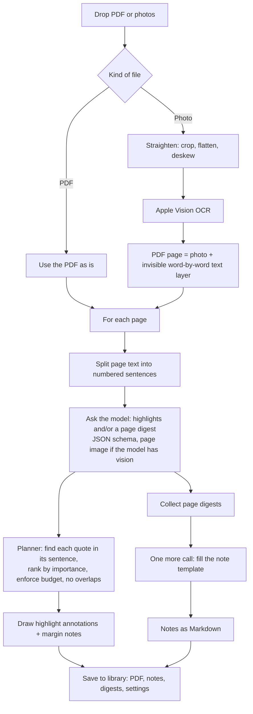

# 1. Overview

[← Docs index](README.md) · Next: [2 Using the app →](02-using-the-app.md)

## What AI Annotator is

AI Annotator is a small native Mac app for studying. You give it a reading, a digital PDF or phone photos of printed
pages, and a language model running **on your own Mac** (through [Ollama](https://ollama.com)) produces either or both of:

- **Highlights and annotations** drawn on the pages in a chosen style: color-coded categories, short margin comments,
  and a list of every highlight you can browse and edit.
- **Study notes** written in a chosen template: Cornell notes, an outline, key terms with a summary, or a study guide
  with practice questions and flashcards.

Nothing is sent to the internet. The model, the OCR (Apple Vision) and every file stay on the Mac.

## Goals

These came from the original planning interview and drove most decisions:

| Goal | How it shows up |
|------|-----------------|
| **Local only** | Talks only to Ollama at `127.0.0.1:11434`. OCR uses Apple's on-device Vision framework. |
| **Use a model already on the Mac** | Lists the models Ollama has installed; defaults to `gemma3:12b`, which can also look at page images. |
| **Works on real school material** | Digital PDFs and phone photos (tilted, curved, shadowed) are both first-class inputs. |
| **Highlights that are accurate and restrained** | The model points at sentences and quotes exact words; the app, not the model, enforces how much gets highlighted. See [5](05-highlighting-pipeline.md). |
| **Notes in familiar formats** | Four built-in templates, plus your own. Exports to Markdown and a formatted PDF. |
| **You stay in control** | Add, recolor, re-note and delete highlights; edit notes; redo with other settings; undo the redo. |
| **Native and calm** | SwiftUI + PDFKit, a quiet indigo-and-gold design, no Electron, no web views. |
| **Buildable without Xcode** | A Swift Package plus a bundle script; works with only Apple's Command Line Tools. See [13](13-building-and-testing.md). |

Non-goals: cloud models, accounts, sync, collaborative editing, very long books (it is tuned for about 1–20 pages),
and handwriting recognition.

## Design principles

1. **The model never guesses positions.** It returns *text* (an exact quote and the number of the sentence it comes
   from). The app finds that text on the page and asks PDFKit for the exact word boxes. This is why highlights land on
   the right words. See [6 Quote matching](06-quote-matching.md).
2. **Constrain the model's output, then check it anyway.** Every request carries a JSON schema (Ollama's structured
   outputs), so replies always parse. The app still validates everything: unknown sentences, quotes that can't be found,
   quotes that are too long, overlaps, and the density budget.
3. **The app enforces restraint.** Models over-highlight even when told not to. The planner keeps only the most
   important suggestions that fit a budget based on how long the page is. See [5](05-highlighting-pipeline.md#the-planner).
4. **Standard formats out.** Highlights are ordinary PDF annotations, so they show in Preview and other PDF apps.
   Notes are Markdown.
5. **Logic lives in a tested library.** `AnnotatorCore` holds everything that isn't UI and has 38 tests, including
   real runs against Ollama. See [13](13-building-and-testing.md).

## The pipeline at a glance

Each box has its own chapter:

| Stage | Chapter | Main code |
|-------|---------|-----------|
| Open files, photos → PDF pages | [4](04-ingest-and-ocr.md) | `Sources/AnnotatorCore/Ingest.swift` |
| Numbered sentences, prompts, schemas | [5](05-highlighting-pipeline.md) | `Highlighting.swift`, `PromptBuilder.swift` |
| Talking to the model | [8](08-ollama-integration.md) | `OllamaClient.swift` |
| Choosing highlights | [5](05-highlighting-pipeline.md#the-planner) | `Highlighting.swift` (`HighlightPlanner`) |
| Finding quotes | [6](06-quote-matching.md) | `QuoteMatcher.swift` |
| Drawing highlights | [5](05-highlighting-pipeline.md#drawing-highlights) | `PDFHighlighter.swift` |
| Notes | [7](07-notes-pipeline.md) | `PromptBuilder.swift`, `Notes.swift`, `NotesPDFRenderer.swift` |
| Saving | [10](10-library-and-storage.md) | `Stores.swift` |
| Orchestration, redo, undo | [3](03-architecture.md), [11](11-redo-and-undo.md) | `Sources/AIAnnotator/Session.swift` |

## Numbers worth knowing

| Thing | Value |
|-------|-------|
| Default model | `gemma3:12b` |
| Time per page (gemma3:12b, Apple silicon) | about 20–60 s for highlights and/or a digest |
| Time to rewrite notes from saved digests | one model call, typically under a minute |
| Highlights per full page | Light ≈ 2–4, Balanced ≈ 3–6, Thorough ≈ 5–9 (hard caps 4 / 6 / 9) |
| Highlight length | 3–24 words (the prompt asks for 3–20) |
| Model temperature | 0.2 |
| Context window | 8,192 tokens per page call, 16,384 for the notes call |
| Photo resolution for OCR | longest side up to 3,000 px |
| Page image sent to the model | JPEG, longest side 1,200 px |
