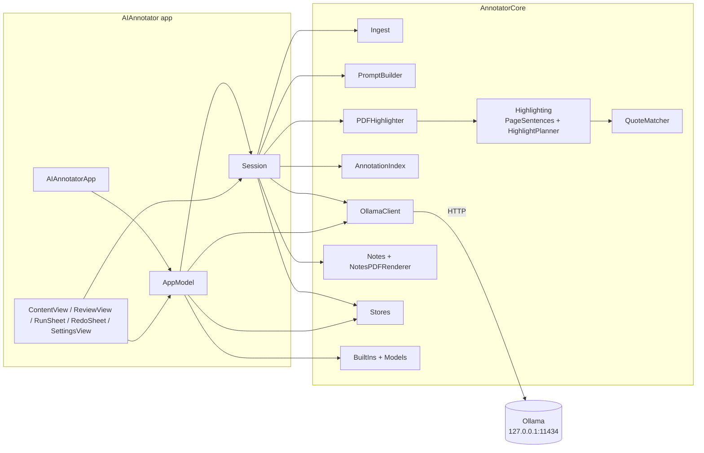
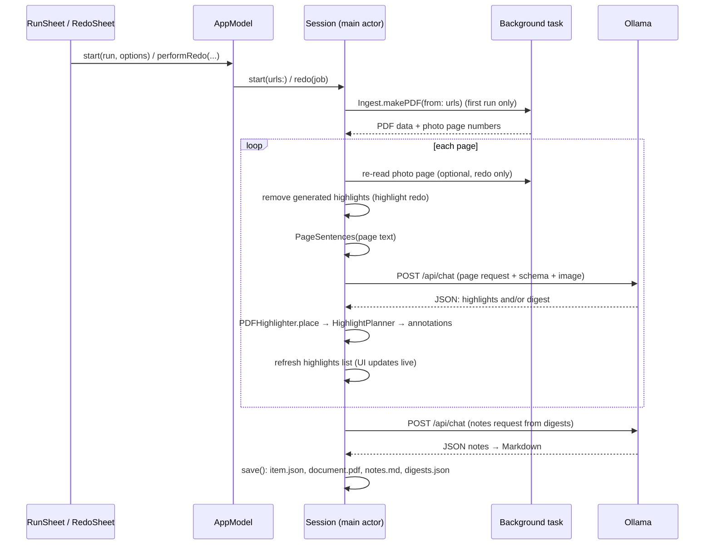

# 3. Architecture

[← 2 Using the app](02-using-the-app.md) · [Docs index](README.md) · Next: [4 Ingest & OCR →](04-ingest-and-ocr.md)

## Shape of the project

AI Annotator is a Swift Package with three targets ([`Package.swift`](../Package.swift)):

| Target | Kind | Depends on | Purpose |
|--------|------|------------|---------|
| `AnnotatorCore` | library | Apple frameworks only | Everything that isn't UI: ingest and OCR, prompts, the Ollama client, quote matching, the highlight planner, drawing annotations, notes formatting and rendering, storage. |
| `AIAnnotator` | executable | `AnnotatorCore` | The SwiftUI app: windows, sheets, the reading screen, settings, and the `Session` that runs a reading. |
| `AnnotatorCoreTests` | tests | `AnnotatorCore` | Swift Testing suites; see [13](13-building-and-testing.md). |

- **Platform:** macOS 14 or later. **Tools:** Swift 6 package format, compiled in Swift 5 language mode
  (`swiftLanguageModes: [.v5]`) so strict-concurrency checks don't block the PDFKit/AppKit code.
- **No third-party dependencies.** Frameworks used: SwiftUI, AppKit, PDFKit, Vision, CoreImage, CoreText,
  NaturalLanguage, ImageIO, Foundation (URLSession).
- About 4,500 lines of Swift in total.

Splitting the logic into a library has two benefits: it can be unit-tested without launching the app, and the UI
target stays focused on presentation.

## Source tour: `AnnotatorCore`

| File | What it contains |
|------|------------------|
| [`Models.swift`](../Sources/AnnotatorCore/Models.swift) | Value types shared everywhere: `RunMode` (notes / annotations / both), `HighlightCategory`, `MarginStyle` (none / popup / margin), `HighlightPreset`, `NoteLayout` (cornell / sections), `NoteSectionSpec`, `NoteTemplate`, `ReadingItem` (a library entry), `HighlightDensity` with its budgets, and `NSColor(hex:)`. |
| [`BuiltIns.swift`](../Sources/AnnotatorCore/BuiltIns.swift) | The three built-in highlight styles and four note templates, in full. See [9](09-presets-and-templates.md). |
| [`Ingest.swift`](../Sources/AnnotatorCore/Ingest.swift) | Turning files into one PDF; photo OCR; straightening (document crop, perspective, deskew); the word-by-word invisible text layer; re-reading a photo page; the page image sent to vision models. See [4](04-ingest-and-ocr.md). |
| [`Highlighting.swift`](../Sources/AnnotatorCore/Highlighting.swift) | `PageSentences` (numbered sentences with exact text ranges) and `HighlightPlanner` (choosing which suggestions to keep). See [5](05-highlighting-pipeline.md). |
| [`QuoteMatcher.swift`](../Sources/AnnotatorCore/QuoteMatcher.swift) | Finding a quote in page text despite whitespace, quotes, dashes, ligatures, hyphenation and small differences. See [6](06-quote-matching.md). |
| [`PromptBuilder.swift`](../Sources/AnnotatorCore/PromptBuilder.swift) | The page request (highlights and/or digest), the notes request, their JSON schemas, and the decoded result types (`PageResult`, `RawHighlight`, `PageDigest`). See [5](05-highlighting-pipeline.md#step-2-the-prompt) and [7](07-notes-pipeline.md). |
| [`PDFHighlighter.swift`](../Sources/AnnotatorCore/PDFHighlighter.swift) | Drawing highlight annotations (with clean, non-overlapping line boxes), margin notes, saving the quote and "made by you" flag in the annotation, reading highlights back, and removing generated annotations. See [5](05-highlighting-pipeline.md#drawing-highlights). |
| [`AnnotationIndex.swift`](../Sources/AnnotatorCore/AnnotationIndex.swift) | Builds the at-a-glance list: every highlight in reading order with its quote, category, note and color. |
| [`OllamaClient.swift`](../Sources/AnnotatorCore/OllamaClient.swift) | The HTTP client: list models, structured chat, vision check, errors. See [8](08-ollama-integration.md). |
| [`Notes.swift`](../Sources/AnnotatorCore/Notes.swift) | Notes result types, the Markdown formatter, a small Markdown parser, and `CornellLayout`, which reads Cornell Markdown back into rows. See [7](07-notes-pipeline.md). |
| [`NotesPDFRenderer.swift`](../Sources/AnnotatorCore/NotesPDFRenderer.swift) | Renders notes Markdown to a paginated US Letter PDF; Cornell gets two columns. See [7](07-notes-pipeline.md#the-notes-pdf). |
| [`Stores.swift`](../Sources/AnnotatorCore/Stores.swift) | `AppPaths`, `PresetStore` (custom styles/templates as JSON), `LibraryStore` (readings), `PageDigestEntry`. See [10](10-library-and-storage.md). |

## Source tour: `AIAnnotator` (the app)

| File | What it contains |
|------|------------------|
| [`AIAnnotatorApp.swift`](../Sources/AIAnnotator/AIAnnotatorApp.swift) | `@main` app: the window (hidden title bar, min 1040 × 680), menu commands and shortcuts, the Reading menu, the Settings scene. An app delegate makes the app a regular foreground app even when run as a bare executable. |
| [`AppModel.swift`](../Sources/AIAnnotator/AppModel.swift) | App-wide state: installed models and Ollama status, the default model, styles and templates, the library, the open `Session`, pending run and redo sheets, remembered choices (UserDefaults). Opens readings, starts runs and redos, saves presets (making category ids unique). |
| [`Session.swift`](../Sources/AIAnnotator/Session.swift) | One open reading: its `PDFDocument`, notes, settings, saved digests, the highlights list, and the run engine (`start`, `redo`, `perform`, `undoRedo`). Also editing (add, select, recolor, re-note, delete) and export. |
| [`ContentView.swift`](../Sources/AIAnnotator/ContentView.swift) | The split view, sidebar (library), home screen, drop handling, Ollama banner. |
| [`ReviewView.swift`](../Sources/AIAnnotator/ReviewView.swift) | The reading screen: header (Redo, Save, Export), status pill, selection bar, the inspector with the highlights list and notes, the PDFKit view wrapper and its click handling, notes preview. |
| [`RunSheet.swift`](../Sources/AIAnnotator/RunSheet.swift) | The new-reading sheet, plus shared pickers (`PresetGrid`, `DensityPicker`, `TemplateGrid`, `ModelPicker`, `OptionSection`, `Legend`). |
| [`RedoSheet.swift`](../Sources/AIAnnotator/RedoSheet.swift) | The redo sheet. See [11](11-redo-and-undo.md). |
| [`SettingsView.swift`](../Sources/AIAnnotator/SettingsView.swift) | Settings: General, Highlight Styles editor, Note Templates editor. |
| [`Theme.swift`](../Sources/AIAnnotator/Theme.swift) | Design tokens and shared controls: colors, the `card()` surface, primary/soft button styles, `ChoiceCard`, `PillPicker`, `FlowLayout`, `SectionLabel`, `BrandMark`. See [12](12-design-system.md). |
| [`ViewState.swift`](../Sources/AIAnnotator/ViewState.swift) | `typealias ViewState = SwiftUI.State`, a workaround for building without Xcode. See [13](13-building-and-testing.md#building-without-xcode). |

Other files:

| Path | Purpose |
|------|---------|
| [`scripts/build-app.sh`](../scripts/build-app.sh) | Release build → `build/AIAnnotator.app` with Info.plist, icon and ad-hoc signature. |
| [`scripts/test.sh`](../scripts/test.sh) | Runs `swift test` with the Swift Testing plugin path. |
| [`scripts/make-icon.swift`](../scripts/make-icon.swift) | Draws the app icon in code and writes `Resources/AppIcon.icns` and `.png`. |
| `Resources/AppIcon.icns`, `AppIcon.png` | The generated icon. |

## Data flow of a run

A run is one call to `Session.perform(_ job:)`. The same function handles a first run and every redo; the `Job` says
what to do: highlights and/or notes, the options, and whether to re-read photo pages.

What `perform` decides, in order:

1. Update the reading's settings from the job (style and density for highlights; template for notes; the model).
2. **Do the notes need fresh page digests?** Yes if this run also highlights (the pages are being read anyway), or if
   the saved digests don't cover every page. Otherwise the saved digests are reused and no page is read.
3. **Read pages** if highlighting or if digests are needed. Per page: optionally re-read the photo, clear generated
   highlights, build numbered sentences, ask the model for `.annotations`, `.notes` or `.both` (whichever this page
   needs), place highlights, collect the digest.
4. **Write notes** from the digests with one more call, if the job includes notes.
5. Set the final status; the run wrapper then saves.

## Concurrency model

- `Session` and `AppModel` are `@MainActor`. All PDFKit mutation (adding and removing annotations, inserting pages)
  happens on the main actor, because PDFKit objects are not thread-safe and the PDF view displays them.
- Heavy work that doesn't touch live PDFKit objects runs in `Task.detached`:
  - `Ingest.makePDF(from:)`, which reads files, runs OCR and builds the PDF data.
  - Re-reading a photo page: the page is copied into a one-page PDF, passed as `Data`, OCR'd in the background, and
    a new page is created from the result back on the main actor.
- Model calls are `async` URLSession requests, so the UI stays responsive while waiting (often 20–60 s per page).
- A run is a single `Task` stored on the session. **Stop** cancels it; `Task.checkCancellation()` runs before each page
  and before the notes call, and URLSession requests are cancelled with the task. Finished pages are kept.
- `OllamaClient`, `LibraryStore` and `PresetStore` are `Sendable` value types.

## State and persistence

| State | Where it lives | Saved to |
|-------|----------------|----------|
| Installed models, Ollama status | `AppModel` (refreshed on launch, before sheets, and on Retry) | not saved |
| Default model, last mode/style/template/density | `AppModel` | UserDefaults (`defaultModel`, `lastMode`, `lastPreset`, `lastTemplate`, `lastDensity`) |
| Custom styles and templates | `AppModel` via `PresetStore` | `Presets/highlights/*.json`, `Presets/templates/*.json` |
| A reading's PDF + annotations, notes, digests, settings | `Session` | `Library/<id>/…`, see [10](10-library-and-storage.md) |
| The highlights list | `Session.entries`, rebuilt from the PDF's annotations after every change | derived, not saved |
| Undo snapshot | `Session.beforeRedo` (in memory) | not saved; one level |

The highlights list is always **derived from the PDF's annotations** (`AnnotationIndex.entries`), never kept
separately. That means it can't drift out of sync with what's drawn on the page, and it works for any PDF, including
one whose highlights were edited in another app.
