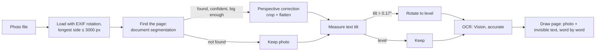

# 4. Ingest & OCR

[← 3 Architecture](03-architecture.md) · [Docs index](README.md) · Next: [5 The highlighting pipeline →](05-highlighting-pipeline.md)

Code: [`Sources/AnnotatorCore/Ingest.swift`](../Sources/AnnotatorCore/Ingest.swift)

Everything the app does later (finding quotes, drawing highlights, reading text for notes) works on a PDF page's
**text layer**. Ingest makes sure every page has a good one: digital PDFs already do, and photos get one built by OCR.

## Supported files

`Ingest.isSupported` accepts `pdf` and these image types: `jpg`, `jpeg`, `png`, `heic`, `heif`, `tif`, `tiff`, `webp`,
`gif`, `bmp`. Files are sorted by name in natural order (`localizedStandardCompare`) before processing, so
`IMG_2.jpg` comes before `IMG_10.jpg`.

## Turning files into one PDF

`Ingest.makePDF(from:)` returns the PDF data plus the 0-based numbers of pages that came from photos:

- **A single PDF** is used exactly as it is, byte for byte. No OCR, no re-rendering.
- **Anything else** (several files, or any photo) is combined into one new PDF in order:
  - each PDF contributes copies of all of its pages;
  - each photo becomes one page via `ocrPage(imageURL:)`, and its page number is recorded as a photo page.

The photo page numbers are saved with the reading (`photoPages` in `item.json`, see [10](10-library-and-storage.md)).
Redo uses them to know which pages can be re-read ([11](11-redo-and-undo.md#re-reading-photographed-pages)).

## Photos: from camera image to searchable page

### 1. Loading

`ocrPage(imageURL:)` loads the image with ImageIO as a thumbnail with:

- `kCGImageSourceCreateThumbnailWithTransform`: applies the photo's EXIF orientation, so a portrait photo taken
  sideways comes in upright;
- `kCGImageSourceThumbnailMaxPixelSize: 3000`: plenty for OCR while keeping memory and PDF size reasonable.

### 2. Straightening (`straightened(_:)`)

Phone photos of pages are rarely flat: the camera is at an angle (perspective), the page is rotated, and there is desk
around it. Straightening fixes as much as it safely can, in two steps.

**Step A: find and flatten the page** (`flattenedDocument`), like a document-scanner app:

- Runs `VNDetectDocumentSegmentationRequest`, which returns the page's four corners.
- Accepts the result only if **confidence > 0.8** and the detected quadrilateral covers **more than 35 % of the photo**
  (area by the shoelace formula). A small "document" is usually a misdetection, such as a sticky note or a phone screen.
- Applies Core Image's `CIPerspectiveCorrection` with those corners. The result is the page alone, flattened to a
  rectangle, without the desk.
- If anything fails, the original photo is kept.

**Step B: level the text** (`textAngle` + `rotated`):

- Runs text recognition once and looks at lines wider than **25 % of the image** (short lines give noisy angles).
- For each line, the angle of its top edge is `atan2(Δy · height, Δx · width)`, measured in pixels so non-square images
  aren't distorted.
- Needs at least **3** such lines; takes the **median** angle, which ignores odd lines such as a tilted caption.
- If the tilt is more than **0.003 radians (about 0.17°)**, rotates the image by the opposite angle around its center,
  composites it over white (so the uncovered corners aren't transparent), and crops to the original size.

Straightening matters for more than looks. OCR returns axis-aligned boxes; on a tilted line those boxes are much taller
than the text, and highlights drawn from them cover several lines. See [14](14-design-decisions.md#photos-made-paragraph-sized-blobs).

### 3. OCR (`recognizeText`)

`VNRecognizeTextRequest` with `recognitionLevel = .accurate` and `usesLanguageCorrection = true`. Vision returns one
observation per text line, roughly top to bottom, each with candidate strings and geometry.

### 4. Building the page (`ocrPage(image:)`)

The page is a PDF drawn with Core Graphics:

- **Size:** 612 points wide (US Letter width); the height keeps the photo's aspect ratio.
- **Background:** white, then the straightened photo stretched to fill the page.
- **Text layer:** for every OCR line, every word is drawn with **invisible** text (`setTextDrawingMode(.invisible)`).
  Invisible text isn't seen, but PDFKit can search it, select it, and give its exact position, so it behaves like a
  scanned document with OCR.

#### The word-by-word text layer

This is the heart of good highlights on photos. For each line:

1. **Split into words** at whitespace (`wordRanges`). Punctuation stays attached to its word.
2. **Find each word's box.** Vision can report the box of any part of a line
   (`VNRecognizedText.boundingBox(for:)`). Each word's own box is used when:
   - the line has more than one word, and
   - the box returned is narrower than 90 % of the line (sometimes Vision answers with the whole line, which is useless).

   Otherwise the line is **shared out by character position**: a word that starts 40 % of the way through the line's
   characters starts 40 % of the way across the line box.
3. **Choose the font size** from the **median word height** in that line, divided by 1.15 (Helvetica's line height is
   about 1.15× its point size). The median is used, not the line box, because a tilted or curved line has an inflated
   box, and one tall word (with ascenders and descenders) shouldn't set the size.
4. **Draw each word** at its own box:
   - horizontally scaled so the word's width matches the box exactly (`scaleBy(x: boxWidth / measuredWidth)`);
   - vertically placed so the text is centered on the box's middle (`y = midY − size/2 + descent/2`);
   - **with a trailing space**, so words on the same line, and the last word of one line and the first of the next,
     are separate in the extracted text.

Why this matters:

| Before (one run per line, no spaces) | After (word by word, with spaces) |
|---|---|
| `…as indeed theyrequired to do by law…` | `…as indeed they required to do by law…` |
| Highlights covered whole paragraphs | Highlights follow each printed line |
| Curved pages: boxes drifted off the text | Each word sits where it's printed |

Because words are placed individually, highlights also follow gentle curves near a book's spine: each word's box is
where that word actually is.

### Limits

- The *straightening* is global: it can't uncurl a strongly bent page. Words still land in the right place (step 4),
  but a highlight on a curved line is a series of flat boxes.
- OCR errors become text errors: a misread word can make a quote unmatchable, and that highlight is skipped (it is
  never put somewhere wrong). See [6](06-quote-matching.md).
- Handwriting is not a goal; Vision may read neat handwriting, but results vary.

## Re-reading a photo page (`rereadPhotoPage`)

Used by redo for readings made before the photo fix ([11](11-redo-and-undo.md#re-reading-photographed-pages)):

1. The page is copied into a single-page PDF and passed in as `Data` (so this can run off the main thread).
2. All annotations are removed from the copy, so old highlights aren't burned into the image.
3. The page is rendered to a bitmap with its **longest side at 2,600 px**, over white. The invisible text isn't drawn.
4. That image goes through `ocrPage(image:)`, the same straighten → OCR → word-layer process as a new photo. It's
   already flat, so straightening usually changes little.
5. The new page replaces the old one in the document.

## The page image for vision models (`pageImage`)

When the model can see images, each page request also includes a picture of the page:

- rendered with `PDFPage.thumbnail` so the **longest side is 1,200 px** (about 110 dpi for a Letter page), a good
  balance between legibility for the model and request size;
- encoded as **JPEG at quality 0.8**, then base64 in the request.

The image helps the model with figures, tables and layout. It never decides *where* a highlight goes; quotes do. See
[5](05-highlighting-pipeline.md).

## What isn't OCR'd

A **single PDF is never OCR'd**, even if it is a scan with no text layer. Such pages have no text to quote, so they
get no highlights. Vision models still read them for notes, through the page image. The workaround is to export the scan
as images and drop those in. See [15](15-limitations-and-troubleshooting.md#a-scanned-pdf-gets-no-highlights).
