# 5. The highlighting pipeline

[← 4 Ingest & OCR](04-ingest-and-ocr.md) · [Docs index](README.md) · Next: [6 Quote matching →](06-quote-matching.md)

Code: [`Highlighting.swift`](../Sources/AnnotatorCore/Highlighting.swift),
[`PromptBuilder.swift`](../Sources/AnnotatorCore/PromptBuilder.swift),
[`PDFHighlighter.swift`](../Sources/AnnotatorCore/PDFHighlighter.swift),
[`AnnotationIndex.swift`](../Sources/AnnotatorCore/AnnotationIndex.swift), and the page loop in
[`Session.swift`](../Sources/AIAnnotator/Session.swift).

The pipeline has one job: put **a few highlights, on exactly the right words**, on every page. It is built around two
rules:

1. The model chooses *what* to highlight, as text. The app works out *where* that text is.
2. The model suggests; the app decides. The app enforces length, overlap and how much gets highlighted.

```mermaid
flowchart LR
    T[Page text] --> S[PageSentences:<br/>numbered sentences + exact ranges]
    S --> P[Prompt + JSON schema<br/>+ page image]
    P --> M[(Model)]
    M --> R[Suggestions:<br/>sentence, quote, category,<br/>importance, note]
    R --> L[Locate: quote inside its sentence]
    L --> F[Filter: 3–24 words]
    F --> K[Rank by importance]
    K --> B[Budget + no overlap +<br/>one per sentence]
    B --> D[Draw: clean line boxes,<br/>never over existing highlights]
    D --> N[Margin notes]
```



## Step 1: numbered sentences (`PageSentences`)

The page's text (`PDFPage.string`) is split into sentences with Apple's `NLTokenizer(unit: .sentence)`.

**PDF line breaks.** PDF text has a newline at the end of every *printed* line, and the tokenizer treats a newline as a
sentence boundary, so sentences would be cut into line-sized fragments. Before tokenizing, the code makes a copy of the
text where every **single** newline becomes a space (`(?<!\n)\n(?!\n)` → `" "`; `\r` is first turned into `\n`).
Blank lines, which are paragraph breaks, are kept. The copy has **exactly the same length in UTF-16 units**, because
one character is swapped for one character. So the sentence ranges found in the copy are valid ranges in the original
text, and those ranges are what the rest of the pipeline uses to find positions on the page.

For each sentence the code keeps:

- `range`: its exact `NSRange` in the page's original text;
- `text`: a cleaned version for the prompt (`PageSentences.clean`): words hyphenated across line breaks are joined
  (`hyphen-\nated` → `hyphenated`) and runs of whitespace become one space.

Sentences shorter than 2 characters are dropped (stray page numbers and symbols).

**In the prompt** the sentences appear one per line, numbered from 1:

```
[1] The poor in this sense were remarkably few in New England—a much smaller part of the population than in England or in other parts of British America.
[2] Social attitudes were mixed.
[3] Most towns made a genuine effort to look after their own poor, as indeed they required to do by law.
```

The list is cut off once about **12,000 characters** have been added (each line counts its length plus 6 for the
number), which keeps one page well inside the 8,192-token context window.

Why numbered sentences? Asking the model *which sentence* it is quoting gives the app a precise place to look. A short,
common phrase like "the cell" may appear ten times on a page; inside sentence 14 it appears once. See
[14](14-design-decisions.md#numbered-sentences).

## Step 2: the prompt

`PromptBuilder.pageRequest` builds one request per page. It can ask for highlights, a page digest for notes
([7](07-notes-pipeline.md)), or both in the same call, which saves a full model pass when you choose "Both".

**System message** (the highlight task is filled in from the chosen style and density):

```
You are a careful study assistant helping a student work through assigned reading. You receive one page at a
time as an image plus the text extracted from it.

TASK: HIGHLIGHT the page in the style "<style name>".
<the style's instructions>

Categories (put the id in "category"):
- main: Main idea — Thesis statements, central claims, topic sentences, conclusions.
- …

How to choose:
- Be very selective. <density hint> Never more than <N>. A page with little substance gets 0 or 1.
- Only mark what a student would need when reviewing. Skip introductions, transitions, restatements, headings,
  page numbers, captions and citations.
- Each highlight marks the key phrase inside ONE numbered sentence. Put that sentence's number in "sentence".
- "quote" is copied character-for-character from that sentence: one contiguous span of 3 to 20 words. Pick the
  core phrase, not the whole sentence (unless the sentence is short). No ellipses, no paraphrasing, no added words.
- A highlight must make sense on its own when re-read later. For a name, date or number, include the words that
  say what it is (e.g. "restoration of the monarchy under King Charles II in 1660", not just "1660").
- At most one highlight per sentence. Highlights never overlap.
- "importance": 3 = essential (would be on the test), 2 = useful, 1 = minor. Order highlights by importance.
- Pick the category whose description fits best; if none fits well, leave the passage unmarked.
- <note rule>
- If the page has no meaningful text, return an empty list.

Respond with JSON only.
```

- `<N>` is the smaller of the style's per-page cap and the density's cap.
- The *density hint* is one of:
  - Light: "Mark only the few points a student must remember, usually 2–4 on a full page."
  - Balanced: "Mark the key ideas and their most important support, usually 3–6 on a full page."
  - Thorough: "Mark ideas, support and key details for close study, usually 5–9 on a full page."
- The *note rule* depends on the style's comment setting: for **No comments**, `"note" must be an empty string.`;
  otherwise, `"note" is a short margin comment (at most 12 words) saying why the passage matters or what it connects to.`

**User message:** `Page 3 of 8.`, then the numbered sentences between `<<<` and `>>>`, or
`(no extractable text on this page)`.

**Image:** if the model supports vision, the page picture is attached (see [4](04-ingest-and-ocr.md#the-page-image-for-vision-models-pageimage)).

## Step 3: the schema and the reply

Every request carries a JSON Schema in Ollama's `format` field, so the model can only answer in this shape
([8](08-ollama-integration.md#structured-outputs)). For highlights:

```json
{
  "type": "array",
  "items": {
    "type": "object",
    "properties": {
      "sentence":   { "type": "integer" },
      "quote":      { "type": "string" },
      "category":   { "type": "string", "enum": ["main", "definition", "example", "fact"] },
      "importance": { "type": "integer", "enum": [1, 2, 3] },
      "note":       { "type": "string" }
    },
    "required": ["sentence", "quote", "category", "importance", "note"]
  }
}
```

The `category` enum is built from the chosen style's category ids, so the model can't invent a category. A typical reply:

```json
{"highlights": [
  {"sentence": 4, "quote": "the first written constitution in American history, the Fundamental Orders of Connecticut (1639)",
   "category": "fact", "importance": 3, "note": ""},
  {"sentence": 1, "quote": "the individual's conscience was beyond the control of any civil or church authority",
   "category": "main", "importance": 3, "note": ""}
]}
```

It is decoded into `[RawHighlight]` (`quote`, `category`, `note?`, `sentence?`, `importance?`).

## The planner

`HighlightPlanner.plan(_:sentences:density:maxPerPage:)` turns suggestions into the final set. It's a pure function
(text in, ranges out), which is why it can be tested thoroughly ([13](13-building-and-testing.md)).

### 1. Locate each quote

`HighlightPlanner.locate`:

1. If the suggestion names a sentence number that exists, look for the quote **inside that sentence only**, with the
   full matcher (exact → ellipsis → fuzzy; see [6](06-quote-matching.md)). A loose match is safe inside one sentence. A
   hit is shifted by the sentence's start to get a page range.
2. Otherwise, or if that fails, look **anywhere on the page** with the same matcher. The fuzzy step only accepts a span
   of about the quote's length, so a page-wide match can't run away.
3. If neither finds it, the quote is recorded as **missed** and never drawn. A highlight in the wrong place is worse
   than a missing one.

### 2. Check the length

The located text is counted in words (whitespace-separated). Under **3 words** or over **24 words**, the suggestion is
**dropped**:

- under 3: fragments like "in 1660" mean nothing when you review;
- over 24: the prompt asks for at most 20; 24 allows a little slack, but anything longer is a sentence-and-a-half, which
  is over-highlighting.

### 3. Rank

Candidates are sorted by **importance (3 → 1)**. A missing importance counts as 2. Ties keep the model's own order,
since it was asked to list the most important first.

### The density budget

Three limits work together. For a page with `W` words and `C` characters:

| | Light | Balanced | Thorough |
|---|---|---|---|
| Hard cap (`cap`) | 4 | 6 | 9 |
| One highlight per … words (`wordsPerHighlight`) | 110 | 75 | 50 |
| Max share of the page's characters (`coverage`) | 8 % | 13 % | 20 % |

```
byLength  = max(2, W / wordsPerHighlight)               // short pages still allow 2
maxCount  = max(1, min(style.maxPerPage, cap, byLength))
charBudget = max(140, C × coverage)                     // a floor so short pages can have something
```

Examples:

| Page | Light | Balanced | Thorough |
|------|-------|----------|----------|
| 480 words, ~2,900 chars (a dense textbook page) | ≤ 4 highlights, ≤ 232 chars | ≤ 6, ≤ 377 chars | ≤ 9, ≤ 580 chars |
| 200 words, ~1,200 chars | ≤ 2, ≤ 140 chars | ≤ 2, ≤ 156 chars | ≤ 4, ≤ 240 chars |
| 40 words | ≤ 2, ≤ 140 chars | ≤ 2, ≤ 140 chars | ≤ 2, ≤ 140 chars |

The style's own `maxPerPage` (10, 6 and 7 for the built-ins) can only lower these.

### 4. Accept greedily

Walking down the ranked list, a candidate is accepted only if **all** of these hold:

- fewer than `maxCount` highlights accepted so far;
- it doesn't overlap an accepted highlight (any shared character);
- no accepted highlight is in **the same sentence** (sentence found from where the match starts);
- its length still fits in the remaining character budget.

Anything else counts as **dropped**. A long candidate that doesn't fit doesn't block a shorter, later one that does.

### 5. Output

The accepted highlights, **sorted back into reading order**, each with its exact range, category id and trimmed note,
plus the lists of *missed* (not found) and the *dropped* count.

### Real results

On real textbook pages with gemma3:12b (from the opt-in test in [13](13-building-and-testing.md#real-reading-tests)):

| Reading | Density | Model suggested | Placed | Highlighted |
|---------|---------|-----------------|--------|-------------|
| AMSCO APUSH p. 100 (481 words) | Light | 4 | 3 | 6 % of words |
| AMSCO APUSH p. 100 | Balanced | 6 | 5 | 12 % |
| 5 phone photos of a history text | Light, Margin commentary | 19 | 15 (1 not found, 3 cut by the budget) | 5–7 % per page |

## Drawing highlights

`PDFHighlighter.place` draws the planner's output on the page.

### Never over an existing highlight

Before drawing, each planned highlight's line boxes are compared with every highlight already on the page. If any
line box shares a text line with an existing one and overlaps it horizontally by more than 1 point, the new highlight
is skipped and counted as dropped. This protects highlights **you** made when the AI runs again
([11](11-redo-and-undo.md)).

### Line boxes (`highlight(_:on:color:contents:manual:)`)

A highlight annotation is one `PDFAnnotation` of type `.highlight` whose shape is a list of **quadrilaterals**, one per
line of text:

1. `selection.selectionsByLine()` gives one selection per text line; each one's bounds on the page is a line box.
   Boxes thinner than 0.5 pt are ignored.
2. Each box is **trimmed by 6 % of its height at the top and the bottom**. PDFKit's line boxes include generous leading,
   so untrimmed boxes on consecutive lines overlap, and translucent color stacks into darker bands.
3. **Your highlights win.** If an existing highlight is mostly covered by the new one (on the same line, overlapping by
   more than half the shorter box's width), the existing one is removed, along with its margin note. This is what
   happens when you select text over a highlight and pick a color: it replaces rather than stacks.
4. **Separate what's left** (`separated`). For any two boxes that overlap horizontally and vertically but are on
   *different* lines, the boundary is moved to the midpoint between them. Within the new highlight, both boxes move;
   against other highlights already on the page, only the new box moves. Boxes squeezed below 1 pt are dropped.
5. **Same line vs. different line** (`sameLine`): two boxes are on the same line if they overlap vertically by more than
   **60 %** of the shorter box's height.
6. The annotation's bounds are the union of the boxes, and each box becomes four quad points relative to that origin,
   in PDF order: top-left, top-right, bottom-left, bottom-right.

Properties set on every highlight:

| Property | Value |
|----------|-------|
| `color` | the category color at **45 % opacity** (`highlightAlpha = 0.45`) |
| `contents` | `"Category"`, or `"Category: note"` when there's a note and the style shows comments |
| `userName` | `"AIAnnotator"` |
| `/AIQuote` (custom key) | the exact highlighted text, whitespace-cleaned |
| `/AIManual` (custom key) | `"yes"` on highlights you made yourself |

The custom keys are saved inside the PDF and survive reopening; see [10](10-library-and-storage.md#inside-the-pdf).

### Margin notes (`addMarginNote`)

Only for styles with **Visible margin notes** (Margin commentary, Literary analysis), and only when the note isn't empty.

- **Where:** the app measures the page's text block (the bounds of selecting all of its text) and puts the note in
  whichever side margin is wider. If neither side has at least **64 points** free, it uses a small **sticky-note icon**
  (18 × 18 pt, `.comment` style) at the right edge, level with the highlight; its text appears when clicked.
- **Size:** width is the smaller of (margin − 14) and 150 pt; height is measured from the text in **7.5 pt** system
  font, plus 12 pt for PDFKit's internal padding, so the last line isn't cut off.
- **No stacking:** if a note would overlap a previous one on the page, it moves down 4 pt at a time until it fits.
- **Look:** a `.freeText` annotation, text in near-black (white 0.15), background the category color at **22 %**
  opacity, no border.

Styles with **Comment on hover** (Color-coded study) don't add a separate annotation; the note is part of the
highlight's `contents`, which PDF apps show when you hover over or open the highlight.

## The highlights list (`AnnotationIndex`)

The side panel's list is rebuilt from the PDF after every change:

- **Order:** page by page; within a page, top to bottom by each highlight's first line box (a 2 pt tolerance counts as
  "the same line"), then left to right.
- **Text:** `PDFHighlighter.text(of:)` returns the saved `/AIQuote`. For highlights without it (made in another app,
  or older ones), it reads the text from the page as one selection running from the first line box to the last, which
  keeps the spaces between lines.
- **Category:** the `contents` is split at the first colon into a label and a note. The label is matched to a category
  name in the reading's style. If there's no match (the style was renamed, or the highlight came from elsewhere), the
  category with the **nearest color** is used, as long as the squared RGB distance is under 0.12.
- **Color:** the annotation's color at full opacity, for the card's color bar.
