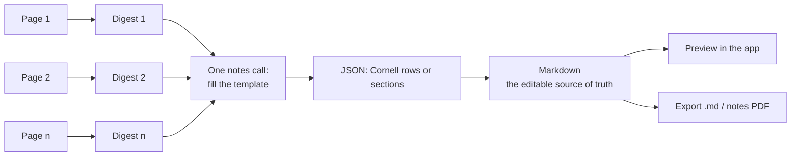

# 7. The notes pipeline

[← 6 Quote matching](06-quote-matching.md) · [Docs index](README.md) · Next: [8 Ollama integration →](08-ollama-integration.md)

Code: [`PromptBuilder.swift`](../Sources/AnnotatorCore/PromptBuilder.swift) (digest and notes requests),
[`Notes.swift`](../Sources/AnnotatorCore/Notes.swift) (formatting, parsing, Cornell layout),
[`NotesPDFRenderer.swift`](../Sources/AnnotatorCore/NotesPDFRenderer.swift) (the notes PDF), the notes step of
`Session.perform` in [`Session.swift`](../Sources/AIAnnotator/Session.swift).

Notes are written in **two passes**:



Why two passes? A 20-page reading doesn't fit in one prompt, but 20 short digests do. Digests also capture what's in
figures (vision models see the page image), and they're **saved**, so the notes can be rewritten in another template
later with one call ([11](11-redo-and-undo.md#redoing-notes)).

## Pass 1: page digests

When the run includes notes, each page request also asks for a digest. With "Both" this is the **same call** as the
highlights, so it costs nothing extra. The task added to the system message:

```
TASK: DIGEST what a student needs from this page for their notes.
- "summary": 1–3 sentences on what this page covers.
- "key_points": the important ideas, claims, facts, steps and examples, each a concise self-contained statement.
- "terms": vocabulary or named concepts explained on the page, each with a short definition.
Use information from figures and diagrams in the image as well. Use empty lists when the page has nothing relevant.
```

Schema (all three fields required):

```json
{ "summary": "string",
  "key_points": ["string"],
  "terms": [ { "term": "string", "definition": "string" } ] }
```

Each digest is stored as a `PageDigestEntry(page: n, digest:)` and saved to the reading's `digests.json`
([10](10-library-and-storage.md)). Pages without text are still sent when notes are wanted; a vision model can still
describe a figure-only page from its image.

## Pass 2: filling the template

`PromptBuilder.notesRequest(template:title:digests:)` makes one request with a larger context window
(**16,384 tokens**).

**System message:**

```
You are an expert note-taker turning a student's reading into study notes with a specific template.

TEMPLATE: <template name>
<template instructions>
<layout guide, below>

Base everything on the page digests provided; do not invent facts. Be concise and student-friendly. Use **bold** for
key terms. "title" is a short title for the reading. Respond with JSON only.
```

**User message:** `Reading: <title>` then `PAGE DIGESTS:` with one block per page:

```
--- Page 3 ---
Summary: …
Key points:
- …
Terms:
- Mitosis: Cell division
```

### Layout guides and schemas

There are two layouts. Every template uses one.

**Cornell** (`.cornell`):

> Fill "rows": each row has a "cue" (a short question a student can quiz themselves with, e.g. "What does ATP do?") and
> "notes" (1–5 concise bullet points that answer it). Notes contain only answers: never repeat or rephrase the cue,
> never write questions in notes, and don't number the bullets. Aim for 5–12 rows that cover the whole reading in
> order. "summary" is a 3–5 sentence summary of the entire reading.

```json
{ "title": "string",
  "rows": [ { "cue": "string", "notes": ["string"] } ],
  "summary": "string" }
```

**Sections** (`.sections`), used by Outline, Key terms + summary, and Study guide:

- If the template lists **no sections**, the model chooses headings that mirror the reading's structure.
- If it lists sections, the model must use **exactly those headings, in that order**, each with its guidance, for
  example `- "Key Terms": Each item is "**Term** — definition in plain words". Include every important term.`
- Either way: `Each item has "text" and a nesting "level" (0 = main bullet, 1 = sub-bullet, 2 = detail).`

```json
{ "title": "string",
  "sections": [ { "heading": "string",
                  "items": [ { "text": "string", "level": 0 } ] } ] }
```

## From JSON to Markdown (`NotesFormatter`)

Markdown is the **single source of truth** for notes: it's what you edit, what the preview shows, and what both
exports read.

### Cornell Markdown

```markdown
# Early Colonies

## Cues & Notes

### Who founded Providence?
- Roger Williams founded Providence in 1636.
- Championed religious freedom.

### What was antinomianism?
- Belief that salvation is achieved through faith alone.

## Summary

Rhode Island, Connecticut and New Hampshire grew out of …
```

Rules:

- Title as `#`, a fixed `## Cues & Notes` heading, each row as `### cue` followed by `- note` bullets, then
  `## Summary` and the summary paragraph.
- Empty notes are dropped, and everything is trimmed.
- **Safeguard:** if a row has more than one note and the first one ends with `?`, it's removed. Models sometimes repeat
  the cue question as the first note even when told not to.

### Sections Markdown

```markdown
# Cell Biology

## Key Terms

- **Mitosis** — division of one cell into two identical cells
  - happens in body cells

## Summary

One paragraph …
```

- Title as `#`, each section as `##`.
- If a section has exactly **one item longer than 160 characters**, it's written as a paragraph (summaries read better
  that way). Otherwise each item is a bullet indented two spaces per level, with levels clamped to 0–3.

## Reading Markdown back (`MarkdownParser`, `CornellLayout`)

Your edits can be anything, so the preview and the PDF renderer parse the Markdown with a small, forgiving parser:

| Line | Becomes |
|------|---------|
| `#` to `######` followed by a space | heading, level 1–6 |
| `- `, `* `, `+ ` or `• ` | bullet; level = leading spaces ÷ 2 (a tab counts as 2) |
| `12. text` | a bullet whose text keeps the number |
| blank line | ends a paragraph |
| anything else | joined with neighboring lines into one paragraph |

Inline: in the PDF, `**bold**` is drawn bold and `__` markers are removed; other emphasis markers are left as typed.
The in-app preview uses Apple's Markdown renderer, which also shows italics and links.

`CornellLayout(markdown:)` turns Cornell Markdown back into rows:

- the first `#` heading is the title;
- a `##` heading containing "summary" (any case) starts the summary; any other `##` ends it;
- each `###` (or deeper) heading outside the summary starts a new row with that cue;
- everything else goes into the current row's notes, or the summary;
- content before the first cue becomes a row with an empty cue, so nothing you typed is lost.

## The notes PDF

`NotesPDFRenderer.render(markdown:layout:)` draws a paginated **US Letter** PDF (612 × 792 pt) with **54 pt margins**
using Core Text, with no web view and no HTML.

**Type:**

| Element | Style |
|---------|-------|
| Title (H1) | 20 pt bold, with a thin rule under it in Sections layout |
| Section (H2) | 14.5 pt bold, blue accent (RGB 0.18, 0.36, 0.62), 12 pt space above |
| Sub-heading (H3+) | 12 pt bold |
| Bullets | 10.5 pt; markers • ◦ ▪ by level; 14 pt indent per level; wrapped lines hang under the text |
| Paragraphs | 10.5 pt, line spacing 18 % of size |

**Cornell layout:**

- Title, then a header row "CUES" / "NOTES" in small blue capitals with a 1 pt accent rule. **The header repeats at the
  top of every page.**
- The cue column is **30 %** of the content width minus a 14 pt gap; notes take the rest.
- Each row is as tall as the taller of its cue and notes plus 16 pt, with a light vertical rule between the columns and
  a light horizontal rule under the row.
- A **Summary** block follows under a 1 pt accent rule, with a 13 pt heading.

**Pagination:** before each block, the renderer checks whether it fits; if not, it starts a new page, unless the page
is still nearly empty, so a block taller than a page doesn't create blank pages. Tested by `longNotesPaginate`.

## The in-app preview

`NotesPreview` in [`ReviewView.swift`](../Sources/AIAnnotator/ReviewView.swift) mirrors the PDF: Cornell notes appear
as rows with a 130 pt cue column, a divider and the notes, and the summary under an indigo heading; Sections notes
appear as headings, bullets and paragraphs. Text is selectable.
